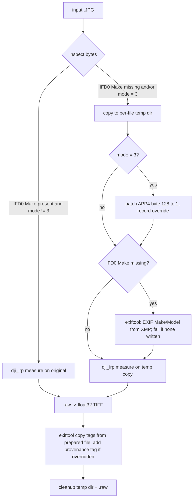

# M4T Super-Resolution R-JPEG Support - Plan

## Goal Capsule

**Objective:** Thermal Tools converts DJI Matrice 4T images shot in infrared super-resolution (high-res) mode into radiometric float32 TIFFs, exactly as it already does for normal images.

**Authority:** This plan's Product Contract > Key Technical Decisions > repo conventions in `lib/main.dart`.

**Stop and surface instead of guessing if:** any DJI reference image produces a different TIFF after the change; the DJI SDK rejects a prepared copy with an error other than the two diagnosed here; or the fix would require writing to the user's input folder (other than `converted/`).

---

## Product Contract

### Summary

M4T super-resolution images fail in every DJI Thermal SDK release (v1.7 bundled, v1.9 latest) for two independent reasons. Thermal Tools will prepare a temporary copy of each such image that removes both obstacles, run the SDK on the copy, and mark which outputs were adjusted.

### Problem Frame

In super-resolution mode the M4T writes a 1280×1024 visible JPEG, while the radiometric payload (APP3) stays the native 640×512 uint16. Files come straight off the SD card. Running the bundled `dji_irp` on them fails:

1. **`-7 DIRP_ERROR_RJPEG_PARSE`:** the EXIF IFD0 holds only Orientation; Make/Model exist only in XMP, so the SDK cannot identify the camera. Restoring `EXIF:Make`/`EXIF:Model` from XMP lets the handle open.
2. **`-64 DIRP_ERROR_SUPER_MODE` ("unsupported super mode picture"):** byte 128 of the DJI APP4 header is an image-mode field. Every DJI reference image with this header family has `1`; super-res files have `3`. Setting it to `1` lets `measure` succeed.

The JPEG frame size is irrelevant: the SDK reads 640×512 from the payload, and `extract` output is byte-identical with or without downscaling the visible image. No resize is needed.

### Requirements

- **R1.** M4T super-resolution R-JPEGs convert to 640×512 float32 TIFFs through both the GUI and `--input` batch mode.
- **R2.** The user's input files are never modified; all adjustments happen on a temporary copy that is removed afterward, on success and on every failure path.
- **R3.** Images whose IFD0 already has Make and whose mode byte is not `3` are passed to the SDK unchanged (same path, no copy), so existing supported drones behave exactly as before.
- **R4.** When the super-mode flag is overridden, the override is visible: a per-file console note, a provenance tag written into that output TIFF, and a count of adjusted files in the GUI status area. (User decision: auto-fix with note, chosen over opt-in flag.)
- **R5.** Works on Linux and Windows using the already-bundled exiftool and SDK; no new runtime dependencies.
- **R6.** Output TIFFs carry `EXIF:Make`/`EXIF:Model` for adjusted images, so downstream tools (WebODM/ODM) identify the camera.

### Scope Boundaries

- No downscaling or re-encoding of the visible JPEG (proven unnecessary).
- No change to temperature math, TIFF encoding, or environment-parameter handling.
- Super-mode flag patch applies only to the `iirp` APP4 header family with value exactly `3`; other values and header families are untouched.

#### Deferred to Follow-Up Work

- **Upgrade bundled DJI TSDK v1.7 → v1.9** (adds M5T, thread-safety). Verified to behave identically for this issue; it swaps the binaries every conversion depends on, so it deserves its own regression pass. When done, re-check whether DJI has added native super-res support that should replace the byte-128 override.
- **Replace the stale counter-template `test/widget_test.dart`**, which does not match the app and fails independently of this change.

### Outstanding Questions

- **Deferred (non-blocking): absolute accuracy of super-res temperatures.** Evidence shows the payload is the native linear thermal frame, but it cannot rule out a super-mode-specific gain/offset. A paired M4T capture (same scene, normal then super-res, seconds apart) compared within ±1 °C would settle it. The user confirmed (2026-10-21) a paired capture is not obtainable, so this ships documented as unverified with R4's provenance marker as the mitigation; README states this.

### Sources

- DJI TSDK v1.9 `tsdk-core/api/dirp_api.h`: `DIRP_ERROR_RJPEG_PARSE = -7`, `DIRP_ERROR_SUPER_MODE = -64`.
- DJI TSDK v1.9 `dataset/` (H20N, H20T, H30T, M2EA, M30T, M3T, M3TD, M4T, M5T, XTS): byte-128 survey and normal-image controls. DJI's M4T reference images carry IFD0 Make, so they take the unchanged path.
- critir.jp M4T conversion guide: super-res changes only the JPEG header size; raw stays 640×512.

---

## Planning Contract

### Key Technical Decisions

- **KTD1. Prepare a temp copy only when a defect is detected.** Detection is pure Dart over the file bytes; untouched images keep today's code path (R3). Chosen over always copying, which adds I/O for every normal image.
- **KTD2. Walk JPEG segments rather than searching for the marker bytes.** Super-res samples carry 11 APP3 segments of raw uint16 before APP4, so `FF E4` can occur inside payloads; the walker stops at SOS. Patch only when APP4 payload starts with magic `ff d2 d1 ff 69 69 72 70` and byte 128 is `0x03` → `0x01`.
- **KTD3. EXIF restore via bundled exiftool, conditional on missing IFD0 Make.** Dart detects absence by parsing the Exif APP1 IFD0 for tag `0x010F`; exiftool copies `XMP:Make`/`XMP:Model` into EXIF on the temp copy. Verified that this leaves APP3/APP5 thermal data byte-identical. Hand-writing an EXIF IFD in Dart was rejected as fragile.
- **KTD4. Copy output tags from the prepared copy, not the original.** The copy is a superset (original XMP + restored EXIF Make/Model), satisfying R6. For unadjusted images the "prepared copy" is the original path, so behavior is unchanged.
- **KTD5. Temp files live in a per-file directory under the system temp dir.** `_prepareInput` owns cleanup of its own dir if it fails; on success, `_convertFile`'s existing `finally` deletes it alongside the `.raw` file (R2). Safe under the parallel worker loop.
- **KTD6. Auto-fix with a visible note** (session-settled: user-directed — chosen over opt-in flag: user wants super-res datasets to just work, with visibility into which files were adjusted).
- **KTD7. Provenance tag in output TIFF: `XMP-dc:Description`** set during the existing `copyExifTags` exiftool call, only for overridden files. Travels with the file into WebODM; no extra process.

### High-Level Technical Design

### Assumptions

- Super-res raw payload is the unmodified native sensor frame, so normal-mode calibration applies. Supported by: APP3 size = 640×512×2, temp-vs-counts correlation 0.9999 (same as DJI control), plausible 11–65 °C range, and correct spatial registration against the camera render. **Absolute accuracy is unverified** (see Outstanding Questions); R4 makes affected outputs identifiable.

---

## Implementation Units

### U1. R-JPEG inspection and patch helpers

**Goal:** Pure-Dart, side-effect-free functions that inspect R-JPEG bytes and produce a patched copy.

**Requirements:** R1, R3; KTD2, KTD3 (detection half).

**Dependencies:** none.

**Files:** `lib/rjpeg_fixup.dart` (new), `test/rjpeg_fixup_test.dart` (new).

**Approach:**
1. Segment walker over SOI → SOS returning marker, payload offset, and length; tolerant of truncated/non-JPEG input (returns "no defects").
2. `isSuperResolution(bytes)`: APP4 magic matches and payload byte 128 == 3.
3. `clearSuperResolution(bytes)`: returns a copy with that byte set to 1; no-op copy otherwise.
4. `hasExifMake(bytes)`: parse the `Exif\0\0` APP1 TIFF header (both byte orders), scan IFD0 entries for tag `0x010F`.

**Patterns to follow:** plain top-level functions like `lib/tiff_encoder.dart`; no Flutter imports so tests run fast.

**Test scenarios:** (synthetic JPEG byte arrays built in the test; no user images committed)
- Super-res fixture (iirp magic, byte128=3) → detected; patched copy has byte128=1, all other bytes identical, input array unmodified.
- Normal fixture (byte128=1) → not detected; patch returns identical bytes.
- Non-iirp APP4 magic with byte128=3 (H20T-style header) → not detected.
- `FF E4` bytes embedded inside an APP3 payload before the real APP4 → walker ignores them, finds the real APP4.
- No APP4 segment → not super-res.
- EXIF IFD0 with Make, little-endian and big-endian → `hasExifMake` true; IFD0 with only Orientation (big-endian, as in the samples) → false; no Exif APP1 → false.
- Empty / non-JPEG / truncated input → no exception, reports no defects.

**Verification:** new tests pass.

### U2. Wire preparation into the conversion pipeline

**Goal:** `_convertFile` prepares a temp copy when needed, runs the SDK and tag copy against it, surfaces overrides, and always cleans up.

**Requirements:** R1, R2, R3, R4, R5, R6; KTD1, KTD3, KTD4, KTD5, KTD6, KTD7.

**Dependencies:** U1.

**Files:** `lib/main.dart`, `README.md`.

**Approach:**
1. New `_prepareInput(path)` returns the path to feed the SDK, an optional temp dir, and whether super-mode was overridden. If no defect → original path, no temp dir.
2. Otherwise create a temp dir, write the (possibly byte-patched) copy keeping the original basename. If `hasExifMake` is false, run bundled exiftool `"-EXIF:Make<XMP:Make" "-EXIF:Model<XMP:Model" -overwrite_original` on the copy; throw on non-zero exit or when exiftool reports no tags written (it exits 0 with "No writable tags set" when XMP lacks Make).
3. If anything after temp-dir creation throws, `_prepareInput` deletes its temp dir before rethrowing.
4. `convertFileToRaw` and `copyExifTags` take the prepared path; the TIFF output name still derives from the original file. `copyExifTags` adds `-XMP-dc:Description=...super-resolution flag overridden...` when overridden.
5. On override: `print` the per-file note, and increment an `_adjustedFiles` counter shown next to the processed/failed status in the GUI.
6. Delete the temp dir in `_convertFile`'s existing `finally` block.
7. README: note M4T super-resolution support under "Supported Drones", including the override marker.

**Patterns to follow:** `copyExifTags` for exiftool invocation and error surfacing; existing `finally` cleanup of `outFileRaw`; `_failedFiles` for the counter's state and display.

**Test scenarios:** Test expectation: covered by U3 end-to-end runs — this unit orchestrates the SDK/exiftool binaries, which only run on Linux/Windows; U1 covers the logic.

**Verification:** U3 passes.

### U3. End-to-end verification in Linux container

**Goal:** Prove the built Linux app converts the super-res images and leaves every DJI reference image unchanged.

**Requirements:** R1–R6.

**Dependencies:** U2.

**Files:** none committed (verification only).

**Inputs (durable, outside the repo, uncommitted):** `../testdata/superres/` (the two samples `DJI_20261019103545_0001_T_…JPG`, `DJI_20261019103551_0005_T_…JPG`) and `../testdata/dji_thermal_sdk_v1.9_20260526/dataset/` (DJI TSDK v1.9 download, `dji_thermal_sdk_v1.9_20260526.zip`).

**Approach:**
1. Environment: amd64 container from `ghcr.io/cirruslabs/flutter:3.22.2` (matches `.fvmrc`) plus `clang cmake ninja-build pkg-config libgtk-3-dev xvfb perl libgomp1`.
2. Build twice — baseline (`main` before this change) and patched — with `flutter build linux`; after each build, `chmod +x` the bundle's `assets/linux/exiftool/exiftool` and `assets/linux/dji_tools/dji_irp*` (as `build.sh` does for the AppDir).
3. Run U1 tests in the patched checkout.
4. Run each bundle in batch mode under Xvfb with `--input` on copies of: the super-res samples; every TSDK `dataset/` drone folder.

**Test scenarios:**
- Super-res samples → 2/2 converted, 640×512 float32 TIFFs; median ≈ 43.0 °C / 38.8 °C (matches the pre-plan SDK experiment); console note per file; TIFF has `EXIF:Make=DJI`, `EXIF:Model=M4T`, and the provenance description.
- Super-res samples on the baseline build → fail (confirms the test exercises the fix).
- Input folders after run contain only originals + `converted/`; originals checksum-identical before/after; no leftover temp dirs in the system temp dir.
- Every TSDK reference folder → patched-build TIFFs byte-identical to baseline-build TIFFs, same success/failure count, no provenance tag, no override note.

**Verification:** all scenarios observed.

---

## Verification Contract

- `flutter test test/rjpeg_fixup_test.dart` passes (legacy `test/widget_test.dart` is known-broken and out of scope).
- `flutter build linux` succeeds with Flutter 3.22.2.
- U3 scenarios pass in the amd64 container.
- Windows path is covered by construction (same Dart code, bundled `exiftool.exe`/`dji_irp.exe` invoked identically); no Windows runtime test is available in this environment — state this in the PR.

## Definition of Done

- U1–U3 complete and their verification observed.
- All DJI reference images produce byte-identical TIFFs to the pre-change build.
- README updated (U2).
- No experimental/scratch code (resize experiments, debug prints beyond the R4 note) left in the diff.
